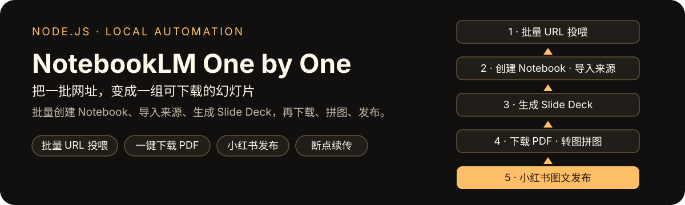

<p align="right"><a href="README.md">中文</a></p>

<p align="center">
  
</p>

<p align="center">
  <a href="https://xiaosang.cc/notebooklm-one-by-one/">▶ Project Page</a>
  ·
  <a href="https://github.com/holynova/notebooklm_one_by_one">GitHub Repository</a>
</p>

NotebookLM One by One is a local Node.js automation tool: feed it a batch of URLs and it drives the NotebookLM CLI (`nlm`) to create notebooks, import sources, and generate Slide Decks in bulk — then downloads the decks as PDFs, converts them into long images, and can publish them to Xiaohongshu. Everything runs locally, with resume support and safe interruption.

## Workflow

```
URL list ──▶ Create Notebook ──▶ Import sources ──▶ Generate Slide Deck
                                                                   │
PDF download ◀── Scan existing projects ────────────────────────────┘
   │
   ▼
PDF → images, stitched into long images ──▶ Xiaohongshu publishing (schedulable, batch-split)
```

## Commands

```bash
pnpm install   # install Node dependencies
```

| Command | Script | What it does |
|---|---|---|
| `pnpm start` | `main.js` | Main entry: environment check, then interactive batch generation |
| `pnpm slide` | `auto_slide.js` | Skip the environment check, generate interactively |
| `pnpm daily` | `daily_slide.js` | Non-interactive batch: runs tasks from `daily_input_json/input.json` |
| `pnpm download` | `auto_download.js` | Scans projects with slide decks, downloads PDFs by range into `slides_downloads/` |
| `pnpm manage` | `manage_notebooks.js` | Management assistant: scan, clean empty projects, dedup, backfill Slides by range |
| `pnpm img` | `pdf_to_img.js` | PDF → images, stitched into Xiaohongshu long images |
| `pnpm xhs` | `xhs_publisher.js` | Xiaohongshu auto-publishing: interactive queue, batch splitting, scheduled posting |

## Quick Start

```bash
pnpm install
pnpm start
```

1. **Environment check** (`check_env.js`): verifies the `nlm` CLI is installed — if not, it offers to install it via `uv tool install notebooklm-mcp-cli`; checks that your Google account is authorized — if not logged in, it opens the browser for authorization.
2. **Batch generation** (`auto_slide.js`): interactively paste a URL list (separated by newlines, spaces, or commas), enter a generation prompt (default: "用中文生成详细的slide", i.e. "generate a detailed slide deck in Chinese"), and it automatically creates a Notebook, imports sources, and generates a Slide Deck for each URL in turn.

Prerequisites: Python `uv` (to install the `nlm` CLI) and a Google account (NotebookLM authorization). Xiaohongshu publishing also requires Playwright Chromium (`pnpm exec playwright install chromium`).

## Features

- **Batch URL feeding**: paste multiple URLs at once; each automatically goes through the Notebook → sources → Slide stages.
- **Non-interactive batch** (`daily_slide.js`): syncs tasks from `daily_input_json/input.json`, up to 10 per batch by default, with resume support, failure retries, and random delays between tasks.
- **Bulk slide downloads**: scans all your projects containing a `slide_deck`, numbers them by time, and downloads PDFs in bulk for a range like `1-10`; pressing `Ctrl+C` mid-scan doesn't crash — it proceeds with the results found so far.
- **Management assistant**: streams through all notebooks, deletes empty projects with 0 sources in one click, checks for duplicate URLs on creation, and can backfill missing Slides by range.
- **PDF → stitched images**: converts PDF pages to images and stitches them by layout (vertical / horizontal, pages per image, pixel gap), outputting Xiaohongshu long images; CLI flags can skip the prompts, e.g. `pnpm img --file 1,2 --layout 1 --grid 4 --gap 10`.
- **Xiaohongshu publishing**: Playwright + stealth drives a headless Chromium to fill titles, upload images, attempt slider captchas, and publish — with an interactive multi-select queue, bulk folder splitting (9 images per post by default), scheduled posting (`--schedule-start` + `--schedule-interval`), and skip-night (`--skip-night`, 23:00–07:00 deferred to 07:00).
- **Logging & interruption**: every CLI command and its output is logged; generation and downloads can both be safely interrupted with `Ctrl+C`, keeping completed results.

## Tech

- Node.js + pnpm; the core drives the `nlm` CLI (`notebooklm-mcp-cli`, installed via `uv tool install`) for NotebookLM operations.
- Xiaohongshu publishing uses Playwright (`playwright-extra` + stealth plugin) to drive Chromium.
- PDF-to-image uses `pdf2pic`, stitching uses `sharp`; configuration uses `dotenv`.
- The task queue (`task_queue.js`) and history (`history.js`) support resumable batches; `logger.js` unifies the log format.

```
main.js                 Main entry: environment check → batch generation
check_env.js            Environment check: nlm installation and Google authorization
install_nlm.js          Installs notebooklm-mcp-cli via uv
auto_slide.js           Interactive batch Slide Deck generation
daily_slide.js          Non-interactive batch: input.json task queue, resumable
auto_download.js        Scans and downloads Slide PDFs by range
manage_notebooks.js     Notebook management: scan / clean empty projects / dedup / backfill
pdf_to_img.js           PDF → images, stitched into long images
xhs_publisher.js        Xiaohongshu auto-publishing (queue / batch splitting / scheduling)
task_queue.js           Task queue: batching, retries, resume
history.js              History records
logger.js               Logging
```
