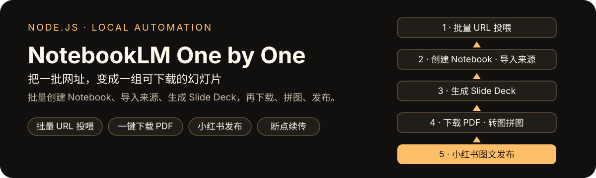

<p align="center">
  
</p>

<p align="center">
  <a href="https://xiaosang.cc/notebooklm-one-by-one/">▶ 项目主页 Project Page</a>
  ·
  <a href="https://github.com/holynova/notebooklm_one_by_one">GitHub 仓库</a>
</p>

NotebookLM One by One 是一个基于 Node.js 的本地自动化工具：只需提供一批 URL，它调用 NotebookLM 命令行（`nlm`）自动创建 Notebook、导入来源、批量生成幻灯片（Slide Deck），再把幻灯片下载为 PDF、转成长图，并可一键发布到小红书。全部在本地运行，支持断点续传与安全中断。

NotebookLM One by One is a local Node.js automation tool: feed it a batch of URLs and it drives the NotebookLM CLI (`nlm`) to create notebooks, import sources, and generate Slide Decks in bulk — then downloads the decks as PDFs, converts them into long images, and can publish them to Xiaohongshu. Everything runs locally, with resume support and safe interruption.

## 工作流 / Workflow

```
URL 列表 ──▶ 创建 Notebook ──▶ 导入来源 ──▶ 生成 Slide Deck
                                                        │
PDF 下载 ◀── 扫描已有项目 ───────────────────────────────┘
   │
   ▼
PDF 转图拼长图 ──▶ 小红书图文发布（可定时、可批量分 P）
```

## 命令 / Commands

```bash
pnpm install   # 安装 Node 依赖
```

| 命令 | 脚本 | 作用 |
|---|---|---|
| `pnpm start` | `main.js` | 主入口：先环境检查，再交互式批量生成 |
| `pnpm slide` | `auto_slide.js` | 跳过环境检查，直接交互式生成 |
| `pnpm daily` | `daily_slide.js` | 非交互批量：从 `daily_input_json/input.json` 取任务执行 |
| `pnpm download` | `auto_download.js` | 扫描带幻灯片的项目，按范围下载 PDF 到 `slides_downloads/` |
| `pnpm manage` | `manage_notebooks.js` | 管理助手：扫描、清理空项目、查重、范围补刷 Slide |
| `pnpm img` | `pdf_to_img.js` | PDF 转图拼图：按排版拼成小红书长图 |
| `pnpm xhs` | `xhs_publisher.js` | 小红书自动发布：交互队列、批量分 P、定时发布 |

## 快速开始 / Quick Start

```bash
pnpm install
pnpm start
```

1. **环境检查**（`check_env.js`）：检查 `nlm` 是否安装——未安装会询问并调用 `uv tool install notebooklm-mcp-cli` 自动安装；检查是否已授权 Google 账号——未登录会自动打开浏览器授权。
2. **批量生成**（`auto_slide.js`）：交互式粘贴 URL 列表（换行、空格、逗号分隔均可），输入生成提示词（默认"用中文生成详细的slide"），自动逐个创建 Notebook、导入来源、生成 Slide Deck。

前置要求：Python `uv`（用于安装 `nlm` CLI）、Google 账号（NotebookLM 授权）。小红书发布还需安装 Playwright Chromium（`pnpm exec playwright install chromium`）。

## 功能细节 / Features

- **批量 URL 投喂**：一次粘贴多个 URL，逐个自动走完 Notebook → 来源 → Slide 三个阶段。
- **非交互批量**（`daily_slide.js`）：从 `daily_input_json/input.json` 同步任务，每批默认最多 10 个，支持断点续传与失败重试，任务间随机延时。
- **幻灯片批量下载**：扫描名下所有含 `slide_deck` 的项目，按时间排序编号，输入 `1-10` 这样的范围即批量下载 PDF；扫描中按 `Ctrl+C` 不会崩溃，直接带着已扫出的结果进入下一步。
- **管理助手**：流式扫描全部 Notebook，一键删除来源为 0 的空项目；新建时做重复 URL 检测；可按范围批量补刷缺失的 Slide。
- **PDF 转图拼图**：PDF 页面转图片后按排版拼接（垂直 / 水平、每张大图放几页、间距多少像素），输出小红书长图；支持命令行参数跳过问答，如 `pnpm img --file 1,2 --layout 1 --grid 4 --gap 10`。
- **小红书发布**：Playwright + stealth 隐身浏览器自动填标题、上传图片、尝试滑块验证码、点击发布；支持交互式多选队列、文件夹批量分 P（默认每篇 9 张图）、定时发布（`--schedule-start` + `--schedule-interval`）与跳过深夜（`--skip-night`，23:00–07:00 顺延到 07:00）。
- **日志与中断**：每一步 CLI 命令与输出都记录日志；生成与下载过程均可 `Ctrl+C` 安全打断，已完成的结果保留。

## 技术 / Tech

- Node.js + pnpm；核心是调用 `nlm` CLI（`notebooklm-mcp-cli`，经 `uv tool install` 安装）完成 NotebookLM 操作。
- 小红书发布用 Playwright（`playwright-extra` + stealth 插件）驱动 Chromium。
- PDF 转图用 `pdf2pic`，拼图用 `sharp`；配置用 `dotenv`。
- 任务队列（`task_queue.js`）与历史记录（`history.js`）支撑断点续传；`logger.js` 统一日志格式。

```
main.js                 主入口：环境检查 → 批量生成
check_env.js            环境检查：nlm 安装与 Google 授权
install_nlm.js          经 uv 安装 notebooklm-mcp-cli
auto_slide.js           交互式批量生成 Slide Deck
daily_slide.js          非交互批量：input.json 任务队列，断点续传
auto_download.js        扫描并按范围下载 Slide PDF
manage_notebooks.js     Notebook 管理：扫描 / 清理空项目 / 查重 / 补刷
pdf_to_img.js           PDF 转图并拼长图
xhs_publisher.js        小红书自动发布（队列 / 批量分 P / 定时）
task_queue.js           任务队列：取批、重试、断点续传
history.js              历史记录
logger.js               日志
```

## English

**NotebookLM One by One** is a local Node.js automation tool: give it a batch of URLs and it drives the NotebookLM CLI (`nlm`) to create notebooks, import sources, and generate Slide Decks in bulk — then downloads the decks as PDFs, stitches them into long images, and can publish them to Xiaohongshu.

- **Commands**: `pnpm start` (env check + interactive batch generation), `pnpm slide` (skip the check), `pnpm daily` (non-interactive batch from `daily_input_json/input.json`, default 10 per batch, resumable with retries), `pnpm download` (scan decks, download PDFs by range like `1-10` into `slides_downloads/`), `pnpm manage` (scan, delete empty notebooks, dedup URLs, backfill missing decks), `pnpm img` (PDF → stitched long images), `pnpm xhs` (Xiaohongshu publishing).
- **Env check**: verifies the `nlm` CLI is installed (offers to install it via `uv tool install notebooklm-mcp-cli`) and that your Google account is authorized (opens the browser to log in if not).
- **Xiaohongshu publishing**: Playwright + stealth drives a headless Chromium to fill titles, upload images, attempt slider captchas, and publish — with an interactive queue, bulk folder splitting (9 images per post by default), scheduled posting (`--schedule-start` + `--schedule-interval`), and skip-night (23:00–07:00 deferred to 07:00).
- **Safety**: every CLI step is logged; `Ctrl+C` safely interrupts generation and downloads, keeping completed results. Pressing `Ctrl+C` during a scan jumps ahead with the results found so far.
- **Prerequisites**: Python `uv` (to install the `nlm` CLI), a Google account authorized for NotebookLM, and Playwright Chromium for Xiaohongshu publishing.
- **Tech**: Node.js + pnpm; `nlm` CLI for NotebookLM; Playwright for publishing; `pdf2pic` + `sharp` for PDF-to-image stitching; `task_queue.js` + `history.js` for resumable batches.

## 许可 / License

ISC（见 `package.json`；本仓库未附 LICENSE 文件）。
